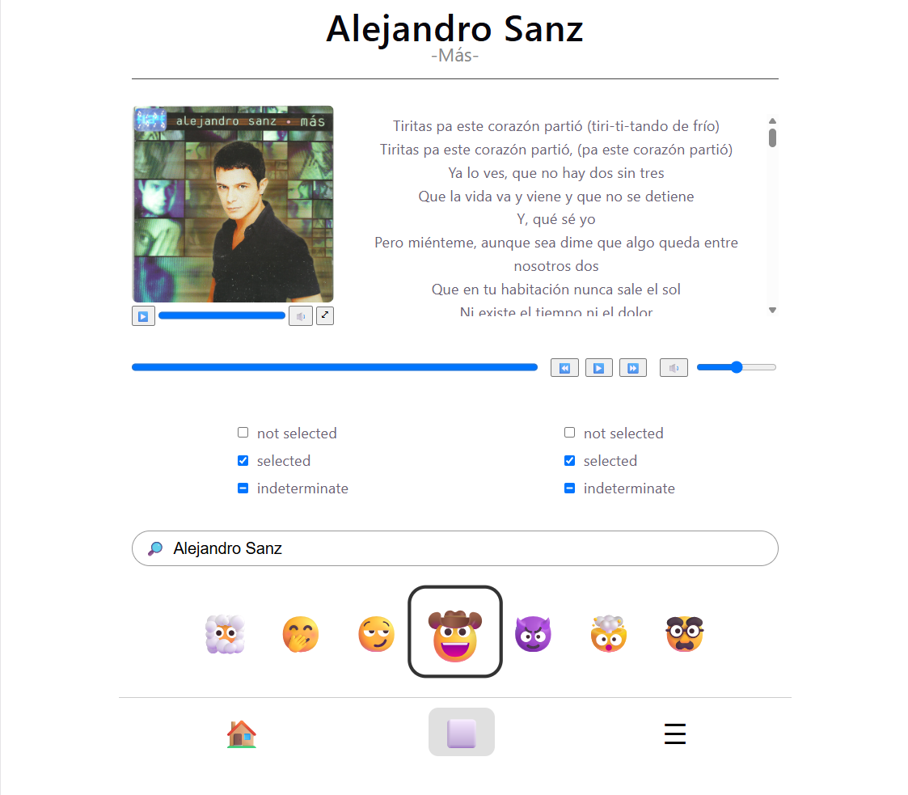

# Reproductor musical

Interfaz de un reproductor musical hecha con **React + Vite**, a partir de un wireframe de Balsamiq.

La aplicacion simula un reproductor de mucsica. No reproduce nada pero creamos botones funcionales.
  - Avance del tiempo.
  - Cambiar el volumen
  - Marcar casillas o seleccionar distintos menus o emojis
  - Cambio de cantante



---

## Requisitos

- [Node.js](https://nodejs.org/) (incluye `npm`)

## Instalación y ejecución

```bash
# 1. Clonar el repositorio
git clone https://github.com/DanielSB93/ReproductorReact
cd ASanz

# 2. Instalar las dependencias
npm install

# 3. Arrancar el servidor de desarrollo
npm run dev
```

Después, abre en el navegador la dirección que aparece en la terminal (normalmente `http://localhost:5173`).

Para generar la versión final: `npm run build`.

---

## Elementos del mockup

| Elemento obligatorio | Componente |
|---|---|
| Encabezado con artista y álbum en dos líneas | `Header` |
| Imagen del cantante con texto descriptivo | `SingerInfo` |
| Controles de reproductor: play/pausa, avance, progreso y volumen | `ControlBar` (y mini-reproductor en `SingerInfo`) |
| Casillas desmarcada, marcada e indeterminada | `GroupBox` |
| Barra de búsqueda con "Alejandro Sanz" | `Buscador` |
| Carrusel de emojis con el central destacado | `Carrusel` |
| Barra de navegación inferior con tres iconos | `Navegador` |

---

## Árbol de componentes

```
App                        → guarda el estado compartido (tiempo, volumen, reproducción)
├── Header                 → nombre del artista y álbum
├── SingerInfo             → foto + texto descriptivo
│   └── BarraInformacion   → mini-reproductor bajo la foto
├── ControlBar             → reproductor principal en una línea
│   ├── BarraProgreso      → barra de tiempo
│   ├── Botones            → reiniciar · play/pausa · cambio de cantante
│   └── Volumen            → silencio + deslizador
├── GroupBox               → muestra de casillas en dos columnas
│   └── CheckBox (×6)      → casilla con sus tres estados
├── Buscador               → barra de búsqueda
├── Carrusel               → emojis con uno destacado
└── Navegador              → barra inferior con tres iconos
```

## Estructura del proyecto

```
ASanz/
├── public/              → archivos estáticos
├── src/
│   ├── assets/          → imágenes (foto del cantante)
│   ├── datos/
│   │   └── datos.js     → datos del cantante (nombre, álbum, foto, descripción, duración)
│   ├── App.jsx          → componente principal y estado compartido
│   ├── App.css          → estilos de los componentes, por secciones
│   ├── index.css        → estilos globales
│   ├── main.jsx         → punto de entrada: monta App en la página
│   ├── Header.jsx
│   ├── SingerInfo.jsx
│   ├── ControlBar.jsx
│   ├── GroupBox.jsx
│   ├── Buscador.jsx
│   ├── Carrusel.jsx
│   └── Navegador.jsx
├── index.html
└── package.json
```

---

## Cómo cambiar de cantante

Los datos de cada cantante se guardan como un objeto en `src/datos/datos.js`, junto con el `import` de su foto:

```js
import fotoSanz from '../assets/sanzmas.jpg'

export const alejandro = {
  nombre: 'Alejandro Sanz',
  album: 'Más',
  foto: fotoSanz,
  duracion: 130,
  desc: `Letra de la canción`
};
```

En `src/App.jsx` se elige qué cantante se muestra, ene ste caso tenemos dos cantantes:

```js
import { alejandro } from './datos/datos.js'
import { david } from './datos/datos.js';

const [datos, setDatos] = useState(alejandro);
```
Podemos añadir nuevos cantantes gaurdando su foto en  `src/assets/` y añadiendo sus datos en `datos.js`.

Para cambiar entre un cantante y otro hemos añadido una funciona en el boton '⏩' que cambia entre uno y otro. Lo hemos echo de forma que solo fucniona con estos dos.
Tambien prodriamos cambiar el ```js useState(david); ``` y cambiar el cantante con el que inicia la App.

---

## Proceso de creación

1. **Análisis del wireframe.** Dividimos el wireframe de balsamic en bloques horizontales divididos por funcionalidad.
2. **Estructura.** Primero creamos los distintos componentes por bloque de forma muy simple, sin estilos ni funcionalidad, es decir, elementos muy sencillos, y comprobamos en el navegador que se muestran todos en orden.
3. **Estilos.** Se maqueta con CSS para que tenga una estructura similar a la del wireframe.

4.  **Pequeño Impass** Hacemos un planteamiento de hasta donde queremos llegar. Decidimos que queremos hacer de más y darle funcionalidad a todos los botones porque nos ayudara a entender React y como ejercicio practico de cara al examen.
Para los primeros elementos nos apoyamos en recursos externos para entenderlo bien y poco a poco vamos haciendo el resto de componentes de forma independiente.

5. **Interacción.** Se ñaden estados con `useState`:
   - Añadimos los estados en el carrusel de Emojis y en el Navegador.
   - Añadimos estados comunes que interactuan en toda la aplicacion en App.jsx. (segundos, volumen,e stado de reproduccion, datos del cantante seleccionado).
   - Volumen con un icono que cambia dinamicamente según el valor;
   - temporizador y checkBox con `useEffect` para el avance de la canción y cambiar entre si esta seleccionado o no la celda. (El useEffect no lo acabo de entender del todo, en ese caso lo he copiado de diferentes fuentes como los apuntes.)
6. **Estado compartido.** En un primer momento definimos los entados en cada componente pero nos dimos cuenta que necesitabamos que fueran elementos definidos en el padre (`App`). Asi que los movemos y se lo pasamos a sus hijos mediante Props. Me sirve para entender como se relacionan los elementos entre si (similar a una clase en JAVA)
7. **Datos separados.** Los datos del cantante se sacaron a `src/datos/datos.js`, para poder cambiar de cantante sin tocar los componentes.
8. **Documentación.** Comentarios en los componentes y en el CSS, y este README.

9. **Conclusión** Esta practica me ha servido para empezar a entender como trabajar y estructurar un proyecto en React. Soy consciente de que hay muchas cosas que no estan bien, por ejemplo, repito muchas funciones como las de reproduccion o cambio de volumen (lo correcto seria un componente con esa funcion). Ademas seguramente podria hacer mejor todo lo relacionado con los PROPS.
---

## Tecnologías

- [React](https://react.dev/)
- [Vite](https://vite.dev/)
- HTML y CSS (Flexbox y Grid)
